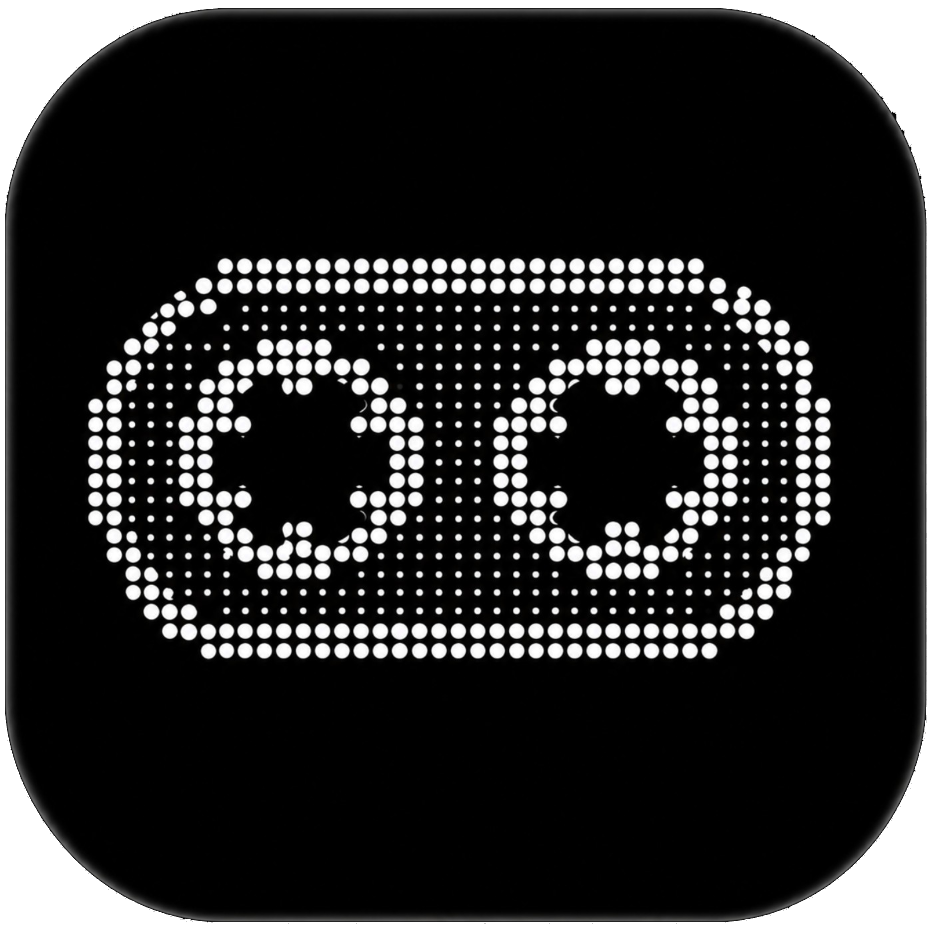
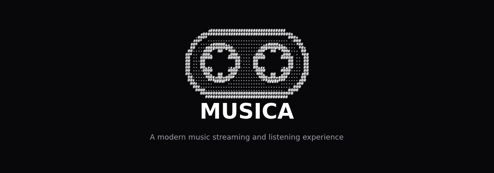
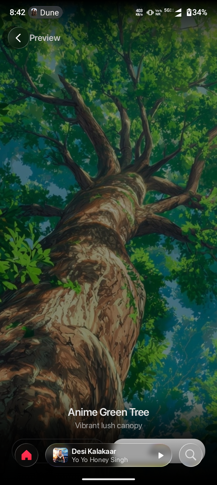
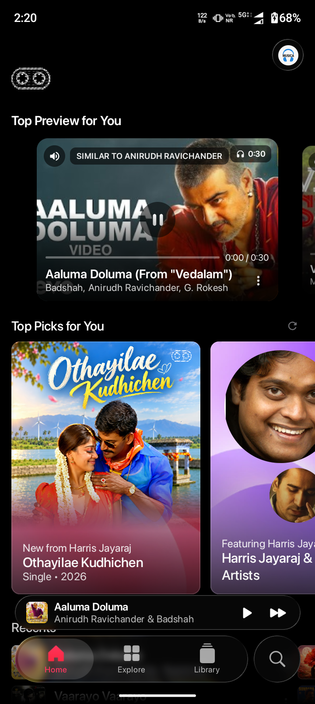
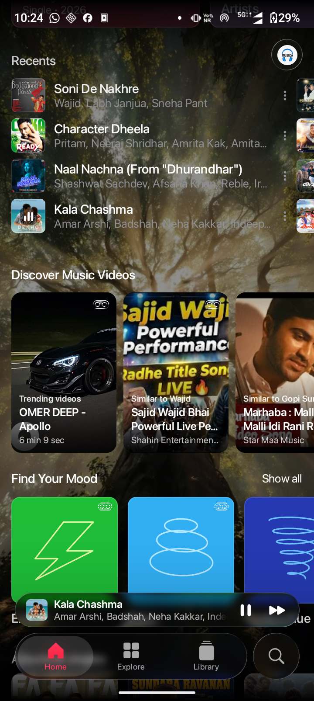
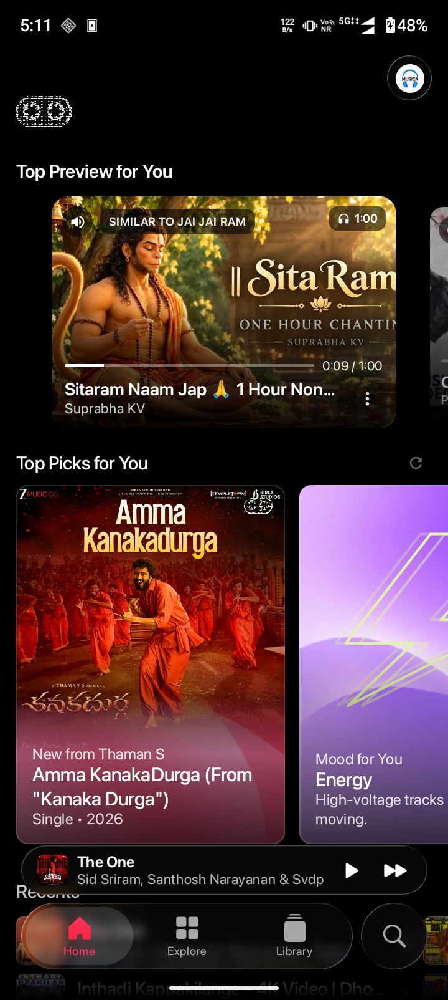
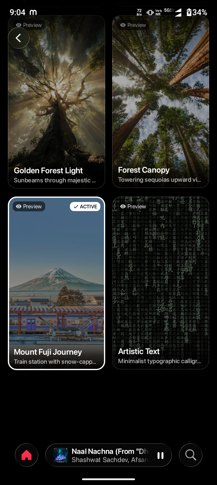
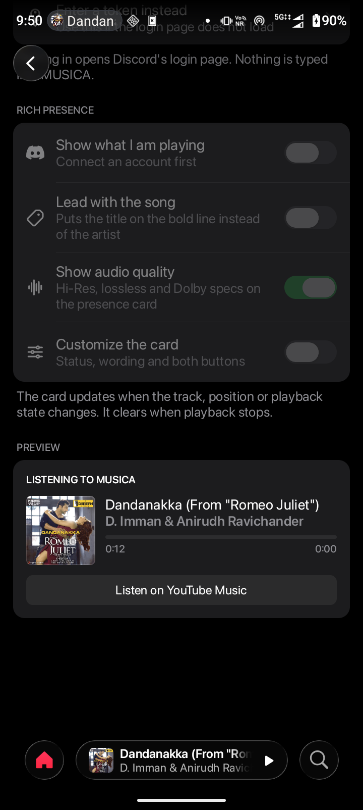

<div align="center">

<br/>



# MUSICA

### A modern music streaming and listening experience with a clean, immersive interface.

<br/>

[](LICENSE)
[](#requirements)
[](https://kotlinlang.org)
[](https://developer.android.com/jetpack/compose)

<br/>

[**About**](#about) · [**Features**](#features) · [**Screenshots**](#screenshots) · [**Download**](#download) · [**Building & Development**](#building--development) · [**Credits**](#credits-and-acknowledgements) · [**License**](#license)

<br/>



</div>

---

## About

**MUSICA** is a modern music application designed around a clean listening experience, immersive visuals, powerful music discovery and convenient playback controls. Built natively for Android using Jetpack Compose, Kotlin Multiplatform, and Media3/ExoPlayer, MUSICA pairs a minimalist dark aesthetic with deep audio configuration, rich real-time lyrics, synced party playback, and extensive personalization.

---

## Features

### 🔍 Music Discovery & Search
- **Instant Global Search**: Search tracks, artists, albums, playlists, and music videos powered by YouTube Music.
- **Top Preview for You**: Full-screen short-video discovery feed with smooth 60-second video previews and immediate audio player handoff.
- **Moods & Genres**: Dedicated discovery grids for exploring curated vibes, activities, and trending releases.

### 🎵 Audio Engine & Playback Controls
- **Foreground Playback Service**: Uninterrupted background audio with full lockscreen, system notification, and Bluetooth media controls.
- **True Gapless & Crossfade**: Smooth track transitions with customizable 0–12 second crossfade.
- **Speed & Silence Trimming**: Fine-grained playback rate adjustments (0.5×–2.0×) and automatic silence skipping.
- **Sleep Timer**: Turn off playback after specified durations or seamlessly at the end of the current track.
- **Advanced Queue**: Drag-and-drop reordering, swipe-to-play-next, swipe-to-queue, and full playback history.

### ✨ Immersive Now-Playing & Lyrics
- **Dynamic Blurred Artwork**: Fluid liquid-glass UI with artwork-driven dynamic background illumination.
- **Word-Synced & Line-Synced Lyrics**: Real-time karaoke-style word highlighting and synchronized scrolling from multiple lyrics providers.
- **On-Demand Lyrics Translation**: Dual-language translation support with timing projection.
- **Stats for Nerds**: Inspect live audio metrics including active codec, bitrate, sample rate, bit depth, and buffer health.

### 📚 Library & Playlists
- **Custom Local Playlists**: Create, reorder, and organize custom playlists with unique artwork.
- **Spotify Integration**: Import Spotify playlists and sync liked songs directly into your MUSICA library.
- **Local Music Storage**: Play music files stored on device storage with embedded tags and album covers.
- **Offline Downloads**: Save tracks with embedded high-resolution metadata for offline playback.

### 🎛️ Audio Controls & Bit-Perfect Output
- **Hardware Equalizer**: Built-in multi-band parametric equalizer with custom curves and genre presets.
- **Bit-Perfect USB Exclusive Audio**: Direct USB DAC bit-perfect output delivering unmodified bit depth and native sample rates.
- **Dolby Atmos Decoding**: Hardware-accelerated spatial audio decoding on supported devices.
- **Direct Source Stream**: Pluggable high-fidelity and lossless audio stream resolution.

### 🎨 Customization & Personalization
- **Shared Backgrounds**: Select from curated aesthetic wallpapers (e.g. Mount Fuji, Forest Canopy, Anime Art) applied consistently across all screens, with pure black default fallback.
- **App Logos**: Switch among 6 launcher icons (Default Red, Pure Black, Pastel Lavender, Mint Green, Sky Blue, Pink) using Android activity-alias switching.

### 🌐 Integrations & Rich Presence
- **Discord Rich Presence**: Share current track, artist, audio quality format, and live progress on Discord with official "Listening to MUSICA" activity.
- **Listen Together (Party Mode)**: Real-time synchronized music playback with friends via low-latency WebSocket synchronization.
- **Scrobbling**: Automatic scrobbling to Last.fm and ListenBrainz.
- **Wear OS Companion**: Control playback, browse playlists, and adjust volume right from your smartwatch.

---

## Screenshots

<div align="center">

| Home (Default) | Now Playing | Custom Wallpaper |
| :---: | :---: | :---: |
|  |  |  |

<br/>

| Video Discovery | Extra Changes & Personalization | Discord Rich Presence |
| :---: | :---: | :---: |
|  |  |  |

</div>

---

## Download

Official signed APK releases will be hosted directly on the [Releases](https://github.com/adharshm38-alt/MUSICA/releases) page.

> [!NOTE]
> Official v1.0.0 APK release binaries are currently in preparation. To run MUSICA on your device today, follow the build instructions below.

### Requirements
- **Device**: Android 8.0 (API level 26) or higher.
- **Architecture**: ARM64 (`arm64-v8a`), ARMv7 (`armeabi-v7a`), x86, or x86_64.
- Sideloading requires enabling *"Install unknown apps"* in your Android security settings.

---

## Building & Development

### Prerequisites
- **JDK**: Java Development Kit 17 (Eclipse Temurin 17 recommended).
- **Android SDK**: `compileSdk = 36/37`, `minSdk = 26`.
- **Android NDK & CMake**: CMake 3.22.1+ and Android NDK (required for C/C++ audio components in `app/src/main/cpp`).
- **Android Studio**: Android Studio Hedgehog / Ladybug or newer.
- **Node.js**: Node 20+ (for `backend/` auth and sync service).
- **Go**: Go 1.22+ (for `backend/` Listen Together party server).

### Clone Repository

```bash
git clone https://github.com/adharshm38-alt/MUSICA.git
cd MUSICA
```

### Build Android App

To build a debug APK with production endpoints:

```bash
# Linux / macOS
./gradlew :app:assembleProdDebug

# Windows PowerShell
.\gradlew.bat :app:assembleProdDebug
```

The compiled APK will be located at:
`app/build/outputs/apk/prod/debug/app-prod-arm64-v8a-debug.apk`

To build the TV application:

```bash
./gradlew :tv:assembleProdDebug
```

### Run Tests

```bash
./gradlew :app:testProdDebugUnitTest
```

### Backend Services

The project includes two backend modules in `backend/`:

1. **Authentication & Cloud Data Service** (Node.js + Express):
   ```bash
   cd backend
   npm install
   npm start
   ```

2. **Listen Together Party Server** (Go + WebSockets):
   ```bash
   cd backend
   go run .
   ```

---

## Credits and Acknowledgements

MUSICA builds upon and extends open-source work from the audio and Android development communities:

- **BitChord**: Base application architecture and design foundation under GPL-3.0.
- **NewPipeExtractor**: Robust YouTube Music extraction and stream parsing.
- **AndroidX Media3 / ExoPlayer**: Production-grade media playback foundation.
- **Jetpack Compose & Kotlin Multiplatform**: Modern, declarative UI framework.
- **Haze (Chris Banes)**: Translucent frosted glass effect components.
- **Lyrics Providers**: [LRCLIB](https://lrclib.net), [Musixmatch](https://www.musixmatch.com), [Genius](https://genius.com), [BiniLyrics](https://github.com/binimum), [PaxSenix](https://lyrics.paxsenix.org), [LyricsPlus](https://github.com/ibratabian17/YouLyPlus), [SimpMusic](https://github.com/maxrave-dev/SimpMusic), and [lrc.red](https://lrc.red).
- **Mornye**: Reference implementation for Android bit-perfect USB audio routing.
- **KizzyRPC**: Discord Rich Presence Android implementation.

---

## Disclaimer

MUSICA is an independent third-party client and media player. It is not affiliated with, endorsed by, or connected to Google LLC, YouTube, YouTube Music, Discord Inc., Spotify AB, or Proton AG.

- **No Media Hosting**: MUSICA does not host, upload, or store copyrighted audio or video media. All playback is requested directly from public or user-authenticated platform endpoints.
- **Fair Use**: This software is provided for personal, educational, and research use. Users are responsible for ensuring their usage complies with relevant local regulations and third-party terms of service.

---

## License

MUSICA is free software licensed under the **GNU General Public License v3.0 (GPLv3)**.

You may copy, distribute and modify the software under the terms of the GNU General Public License as published by the Free Software Foundation, either version 3 of the License, or (at your option) any later version. See the [LICENSE](LICENSE) file for complete terms.
